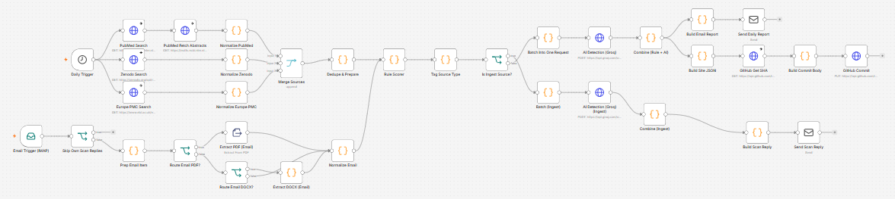
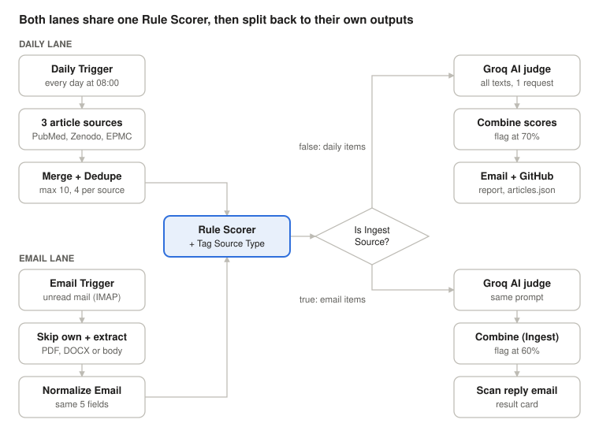
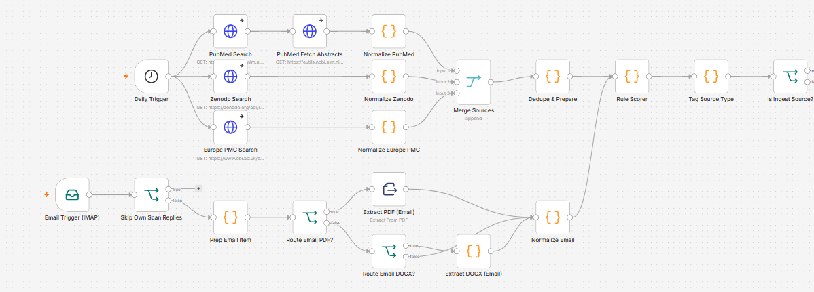
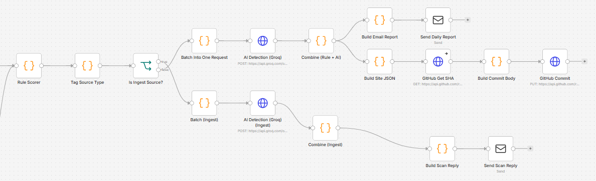
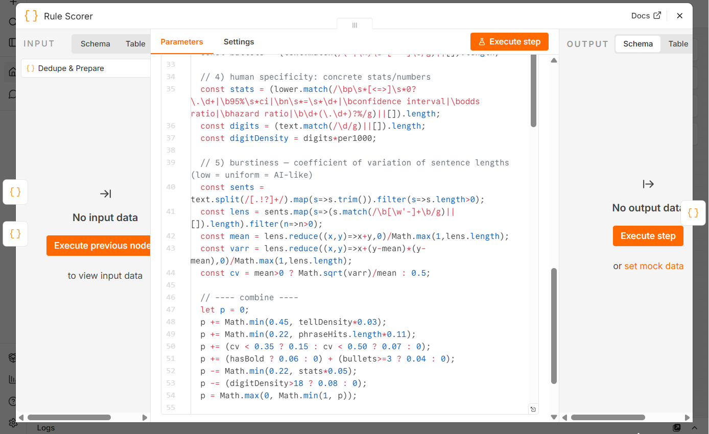
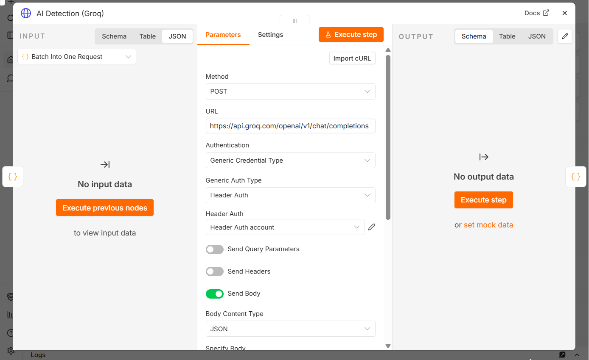
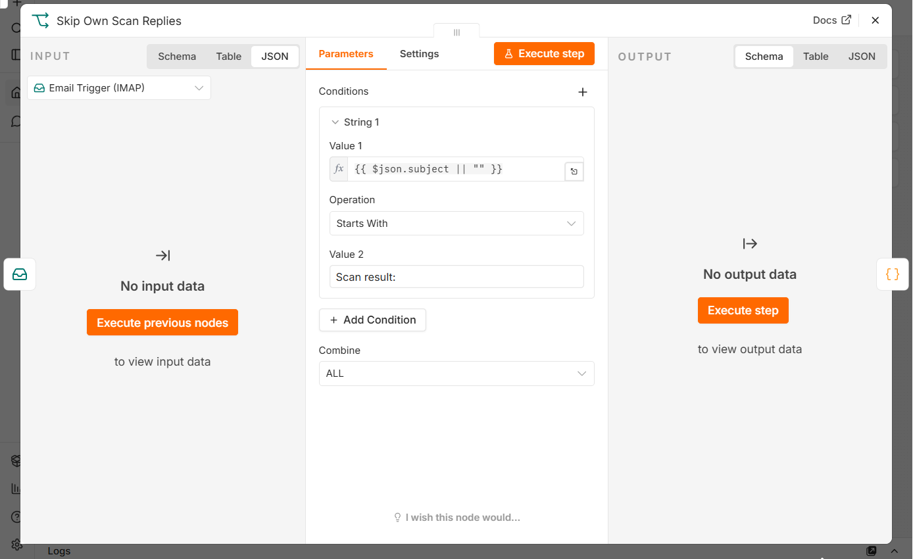
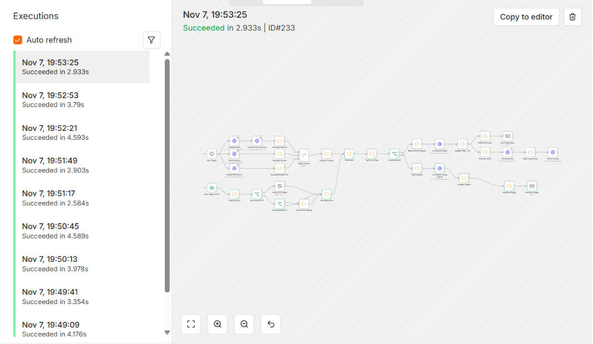

# AI Medical Article Detector

An [n8n](https://n8n.io) workflow that checks how likely medical articles are to be AI-written.

- **Daily scan (08:00):** collects new articles from **PubMed**, **Zenodo** and **Europe PMC** and keeps up to 10 (max 4 per source). Each article is scored twice: by a rule-based detector that needs no API, and by an LLM judge on **Groq** (`openai/gpt-oss-120b`). The workflow then emails an HTML report and commits `articles.json` to a GitHub repo, which a website can display.
- **Email scanner:** send an email, or attach a **PDF** or **DOCX**, to the watched inbox. The workflow extracts the text, scores it the same way and emails back a result card.

> AI-text detection gives probabilities, not proof. Treat flagged articles as leads to check by hand.



## How it works



Both lanes turn their input into the same five fields (`source`, `title`, `text`, `url`, `date`) and pass through one shared **Rule Scorer**. An **If** node then sends each item back to its own lane for the Groq second opinion and the output.

### Rule Scorer (no API)

| Signal | What it counts | Effect on the score |
| --- | --- | --- |
| AI "tell" words | *delve, leverage, robust, pivotal, tapestry, furthermore…* (50 words), per 1,000 words | up to **+0.45** |
| Stock phrases | *"it's important to note", "in conclusion", "plays a pivotal role"…* (15 phrases) | up to **+0.22** |
| Burstiness | how uniform sentence lengths are (humans vary more) | **+0.15** / **+0.07** |
| Formatting | markdown bold or headings, 3+ bullet points | **+0.06** / **+0.04** |
| Concrete statistics | p-values, 95% CI, n = …, odds/hazard ratios, percentages | down to **−0.22** |
| Many digits | more than 18 digits per 1,000 words | **−0.08** |

### Blending with the LLM judge

| Lane | How the final score is blended | Flagged at |
| --- | --- | --- |
| Daily | LLM clearly human (≤ 0.2): capped at 0.15 · LLM clearly AI (≥ 0.8): at least 0.75 · otherwise 0.6 × LLM + 0.4 × rules | ≥ 0.70 |
| Email | rule score under 0.1 (likely poor text extraction): 0.9 × LLM + 0.1 × rules · otherwise 0.65 × LLM + 0.35 × rules | ≥ 0.60 |

## Screenshots

**Inputs and shared scoring:** three article APIs and the email lane both feed the Rule Scorer.



**LLM judge and outputs:** the daily lane (top) emails a report and commits to GitHub; the email lane (bottom) sends a scan reply.



| Rule Scorer code | Groq request |
| --- | --- |
|  |  |

| Loop guard for the email lane | Execution history |
| --- | --- |
|  |  |

## Repository contents

| Path | What it is |
| --- | --- |
| [`workflow.json`](workflow.json) | The n8n workflow, ready to import (no credentials or personal data inside) |
| [`docs/GUIDE.md`](docs/GUIDE.md) | Node-by-node guide: settings, APIs and every Code node explained |
| `docs/images/` | Workflow diagram |
| `docs/screenshots/` | Screenshots from n8n |

## Requirements

- n8n (self-hosted)
- A Gmail account with 2-Step Verification and an **App Password** (used for SMTP and IMAP)
- A free **Groq** API key ([console.groq.com](https://console.groq.com))
- A **GitHub** fine-grained token with *Contents: Read and write* on the repo that stores `articles.json`

PubMed (NCBI E-utilities), Zenodo and Europe PMC are free and need no key.

## Setup

1. **Allow `zlib` in Code nodes** (needed to read DOCX files). Start n8n with:
   ```bash
   NODE_FUNCTION_ALLOW_BUILTIN=zlib
   ```
   With Docker: `-e NODE_FUNCTION_ALLOW_BUILTIN=zlib`
2. **Import the workflow:** in n8n, create a new workflow → **⋯ → Import from File** → choose `workflow.json`.
3. **Create the 4 credentials** and select them in the nodes that use them:

   | Credential | Type | Settings |
   | --- | --- | --- |
   | Gmail SMTP | SMTP | `smtp.gmail.com`, port 465, SSL on, your Gmail address + App Password |
   | Gmail IMAP | IMAP | `imap.gmail.com`, port 993, SSL on, same login |
   | Groq API key | Header Auth | Name `Authorization`, Value `Bearer YOUR_GROQ_KEY` |
   | GitHub token | Header Auth | Name `Authorization`, Value `Bearer YOUR_GITHUB_TOKEN` |

4. **Fill in your own details:**
   - `you@example.com` in *Send Daily Report*, *Send Scan Reply* and *Build Scan Reply*
   - `YOUR_GITHUB_USER/YOUR_REPO` in *GitHub Get SHA* and *GitHub Commit*
5. **Test:** click **Execute workflow** for the daily lane. For the email lane, send yourself an unread email with a PDF and use **Fetch Test Event** on the Email Trigger.
6. **Publish** the workflow so it runs on its own.

## Customising

- **Topics:** `term` in *PubMed Search*, `q` in *Zenodo Search*, `query` in *Europe PMC Search*
- **Number of articles:** `MAX` and `PER_SOURCE` in *Dedupe & Prepare*
- **Thresholds:** `0.7` in *Combine (Rule + AI)* and `0.6` in *Combine (Ingest)*
- **Schedule:** *Daily Trigger* (default 08:00 in the workflow's time zone)

## Notes

- `workflow.json` contains **no secrets**: n8n stores credentials separately, and the export only references them by name.
- The *Skip Own Scan Replies* node prevents a loop. Scan replies go to the same inbox the trigger watches, so without it every reply would be scanned again. Keep it, or use a separate inbox for documents to scan.
