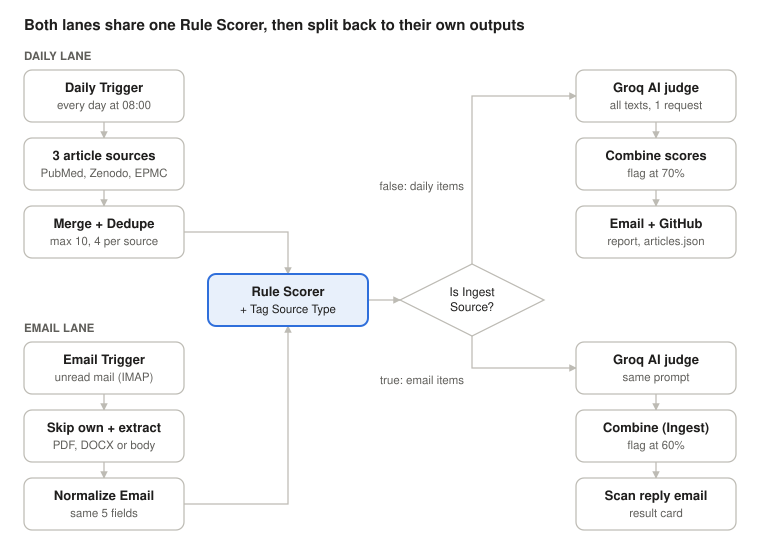

# Workflow Guide – every node explained

A node-by-node walkthrough of the n8n workflow in [`workflow.json`](../workflow.json): what each node does, which settings it uses, which API it calls and how its code works.

## 1. Overview

Every morning at 08:00 this workflow collects up to 10 new medical articles, scores how likely each one was written by AI, then emails you a report and updates `articles.json` on your GitHub site. It also watches your inbox: any unread email (or its PDF/DOCX attachment) gets the same check, and you get a scan-result email back.

The 35 nodes form three parts that share one scoring engine:

- **Daily lane (top):** Daily Trigger → PubMed, Zenodo and Europe PMC → merge → remove duplicates → score → Groq AI second opinion → email report + GitHub commit.
- **Email lane (bottom):** IMAP trigger → skip the workflow's own replies → read the email → extract text from PDF or DOCX → score → Groq AI second opinion → reply email.
- **Shared core (middle):** both lanes pass through the same **Rule Scorer**. The **Is Ingest Source?** node then sends each item back to its own lane.

Every item that reaches the Rule Scorer has the same five fields: `source`, `title`, `text`, `url`, `date`. Each lane's "Normalize" Code node exists to build exactly this shape.



Read it left to right: inputs on the left, the shared Rule Scorer in the middle, and each lane's own Groq check and output on the right.

Once the workflow is **published** (active), both triggers run on their own.

## 2. Before you start: n8n basics, node types and credentials

### How to add and name a node

1. On the canvas, click the **+** button (or press **Tab**). The nodes panel opens.
2. Type the node type from the table below (for example `HTTP Request`) and click it.
3. The node appears with its default name ("HTTP Request"). The names in this workflow ("PubMed Search", "Rule Scorer", ...) were typed by hand: open the node, click its name at the top, and type a new one (or select the node and press **F2**).
4. Connect nodes by dragging from the small circle on the right of one node to the left side of the next.

Names matter here: some Code nodes read other nodes by name, for example `$('Rule Scorer')`. If you rename a node, update the code that mentions it.

### Node types used (what to search for)

| Search in the nodes panel | Used for these nodes | What it does |
| --- | --- | --- |
| Schedule Trigger | Daily Trigger | Starts the workflow at a fixed time |
| Email Trigger (IMAP) | Email Trigger (IMAP) | Starts the workflow when a new email arrives |
| HTTP Request | PubMed Search, PubMed Fetch Abstracts, Zenodo Search, Europe PMC Search, AI Detection (Groq), AI Detection (Groq) (Ingest), GitHub Get SHA, GitHub Commit | Calls any web API |
| Code | All the Normalize, Batch, Build, Combine, Prep, Tag, Dedupe and Rule Scorer nodes (17 nodes) | Runs your own JavaScript |
| Merge | Merge Sources | Joins 3 inputs into one list |
| If | Route Email PDF?, Route Email DOCX?, Is Ingest Source? | Sends items to the true or false output |
| Extract from File | Extract PDF (Email) | Turns a PDF attachment into text |
| Send Email | Send Daily Report, Send Scan Reply | Sends an email over SMTP |

### Three ideas you need to read this workflow

- **Items.** Data moves between nodes as a list of items. Each item has a `json` part (the fields) and sometimes a `binary` part (files such as attachments).
- **Expressions.** A field whose value starts with `{{ }}` is an expression, not fixed text. Switch a field between **Fixed** and **Expression** with the toggle above it. Inside an expression, `$json` is the current item's fields and `$('Node Name')` reads the output of another node.
- **Code node modes.** *Run Once for All Items* gets the whole list with `$input.all()` and must return a list of `{ json: {...} }`. *Run Once for Each Item* runs per item, uses `$json` and `$binary`, and returns one `{ json: {...} }`.

### Accounts and the 4 credentials

Create these under **Overview → Credentials → Create credential** (or from inside the node, in its Credential field). n8n stores the secrets there, not in the workflow.

| Credential name in the workflow | Credential type | What to fill in | Where to get it |
| --- | --- | --- | --- |
| Gmail SMTP | SMTP | Host `smtp.gmail.com`, Port `465`, SSL/TLS on, User = your Gmail address, Password = a Gmail **App Password** | Google Account → Security → turn on 2-Step Verification → App passwords |
| Gmail IMAP | IMAP | Host `imap.gmail.com`, Port `993`, SSL/TLS on, same user and App Password | Same App Password; IMAP must be enabled in Gmail settings |
| Groq API key | Header Auth | Name `Authorization`, Value `Bearer <your Groq API key>` | console.groq.com → API Keys |
| GitHub token | Header Auth | Name `Authorization`, Value `Bearer <your GitHub token>` | GitHub → Settings → Developer settings → Personal access tokens. Give it **Contents: Read and write** on your site repo |

The three article APIs (PubMed, Zenodo, Europe PMC) are free and need no key.

### One server setting: allow `zlib`

The **Extract DOCX (Email)** Code node uses `require('zlib')`. n8n blocks built-in Node.js modules in Code nodes unless you allow them. Start n8n with this environment variable:

```bash
NODE_FUNCTION_ALLOW_BUILTIN=zlib
```

With Docker, add `-e NODE_FUNCTION_ALLOW_BUILTIN=zlib` to your `docker run` command (or put it under `environment:` in docker-compose).

## 3. Part 1 – Daily trigger and the 3 article sources

The Daily Trigger fires three HTTP calls at the same time, one per source. Each source's result then passes through a Code node that turns it into the shared `{source, title, text, url, date}` shape.

### Node 1 – Daily Trigger (Schedule Trigger)

| Field | Value |
| --- | --- |
| Trigger Interval | Days |
| Days Between Triggers | 1 |
| Trigger at Hour | 8am |
| Trigger at Minute | 0 |

The hour uses the workflow's time zone (workflow **Settings → Timezone**). Its output goes to PubMed Search, Zenodo Search and Europe PMC Search.

### Node 2 – PubMed Search (HTTP Request)

PubMed has no single "search and give me abstracts" call. NCBI's free **E-utilities** API works in two steps: `esearch` returns article IDs (PMIDs), then `efetch` returns the full records for those IDs.

| Field | Value |
| --- | --- |
| Method | GET |
| URL | `https://eutils.ncbi.nlm.nih.gov/entrez/eutils/esearch.fcgi` |
| Authentication | None |
| Send Query Parameters | On → Using Fields Below |
| db | `pubmed` |
| term | `medicine` (the search words) |
| retmax | `10` (max results) |
| retmode | `json` |
| sort | `date` (newest first) |
| reldate | `7` (last 7 days) |
| datetype | `pdat` (by publication date) |
| Settings → On Error | Continue |

The answer contains `esearchresult.idlist`, a list of PMIDs.

### Node 3 – PubMed Fetch Abstracts (HTTP Request)

| Field | Value |
| --- | --- |
| Method | GET |
| URL | `https://eutils.ncbi.nlm.nih.gov/entrez/eutils/efetch.fcgi` |
| db | `pubmed` |
| id | Expression: `{{ ($json.esearchresult && $json.esearchresult.idlist ? $json.esearchresult.idlist : []).join(',') }}` |
| rettype | `abstract` |
| retmode | `xml` |
| Options → Response → Response Format | **Text** |
| Settings → On Error | Continue |

The `id` expression takes the PMID list from the previous node and joins it into `123,456,789`. Response Format is Text because PubMed returns XML; n8n puts the raw XML in a field called `data`.

### Node 4 – Normalize PubMed (Code, Run Once for All Items)

```javascript
const out = [];
for (const item of $input.all()) {
  const xml = item.json.data || '';
  const chunks = xml.split('<PubmedArticle>').slice(1);
  for (const c of chunks) {
    const pmid = (c.match(/<PMID[^>]*>(\d+)<\/PMID>/) || [])[1];
    const title = ((c.match(/<ArticleTitle[^>]*>([\s\S]*?)<\/ArticleTitle>/) || [])[1] || '').replace(/<[^>]+>/g, '').trim();
    const abs = [...c.matchAll(/<AbstractText[^>]*>([\s\S]*?)<\/AbstractText>/g)].map(m => m[1].replace(/<[^>]+>/g, '')).join(' ').trim();
    if (pmid && title) {
      out.push({ json: { source: 'PubMed', title, text: abs, url: 'https://pubmed.ncbi.nlm.nih.gov/' + pmid + '/', date: '' } });
    }
  }
}
return out;
```

How it works, line by line:

1. Reads the XML text from `data`.
2. Splits it at every `<PubmedArticle>` tag, so each chunk is one article.
3. For each chunk, uses regular expressions to pull out the PMID, the title and every `<AbstractText>` paragraph.
4. `.replace(/<[^>]+>/g, '')` removes leftover tags such as `<i>`.
5. Builds the article link from the PMID and returns one item per article.

### Node 5 – Zenodo Search (HTTP Request)

Zenodo is CERN's open research repository; its REST API is free.

| Field | Value |
| --- | --- |
| Method | GET |
| URL | `https://zenodo.org/api/records` |
| q | `medical` |
| size | `10` |
| sort | `newest` |
| Settings → On Error | Continue |

### Node 6 – Normalize Zenodo (Code, Run Once for All Items)

```javascript
const out = [];
for (const item of $input.all()) {
  const hits = item.json.hits && item.json.hits.hits ? item.json.hits.hits : [];
  for (const h of hits) {
    const md = h.metadata || {};
    const text = (md.description || '').replace(/<[^>]+>/g, ' ').replace(/\s+/g, ' ').trim();
    out.push({ json: { source: 'Zenodo', title: md.title || '(untitled)', text, url: (h.links && (h.links.self_html || h.links.html)) || '', date: md.publication_date || '' } });
  }
}
return out;
```

Zenodo returns its records in `hits.hits`. Each record's `metadata` holds the title, an HTML description (used as the text, with tags removed and spaces collapsed) and the publication date.

### Node 7 – Europe PMC Search (HTTP Request)

Europe PMC is the European mirror of PubMed Central plus preprints; its REST API is free.

| Field | Value |
| --- | --- |
| Method | GET |
| URL | `https://www.ebi.ac.uk/europepmc/webservices/rest/search` |
| query | `medicine` |
| format | `json` |
| pageSize | `10` |
| resultType | `core` (needed to get `abstractText`) |
| sort | `P_PDATE_D desc` (newest publication date first) |
| Settings → On Error | Continue |

### Node 8 – Normalize Europe PMC (Code, Run Once for All Items)

```javascript
const out = [];
for (const item of $input.all()) {
  const results = (item.json.resultList && item.json.resultList.result) || [];
  for (const r of results) {
    const url = r.doi ? ('https://doi.org/' + r.doi) : (r.pmid ? ('https://pubmed.ncbi.nlm.nih.gov/' + r.pmid + '/') : ((r.id && r.source) ? ('https://europepmc.org/article/' + r.source + '/' + r.id) : ''));
    const text = (r.abstractText || '').replace(/<[^>]+>/g, ' ').replace(/\s+/g, ' ').trim();
    out.push({ json: { source: 'Europe PMC', title: r.title || '', text, url, date: r.firstPublicationDate || '' } });
  }
}
return out;
```

The link prefers the DOI, then the PubMed page, then the Europe PMC page.

**Why "On Error: Continue" on every source:** if one API is down, the other two still reach the report instead of the whole run failing.

## 4. Part 2 – Merge, clean and score (the shared core)

This part joins the three sources, keeps the 10 best-quality articles, and gives each one a rule-based AI score from 0 to 1 without calling any API.

### Node 9 – Merge Sources (Merge)

| Field | Value |
| --- | --- |
| Mode | Append |
| Number of Inputs | 3 |
| Input 1 | Normalize PubMed |
| Input 2 | Normalize Zenodo |
| Input 3 | Normalize Europe PMC |

Append puts all items in one list: PubMed first, then Zenodo, then Europe PMC.

### Node 10 – Dedupe & Prepare (Code, Run Once for All Items)

```javascript
const MAX = 10;       // total articles per run (keeps the Groq request small)
const PER_SOURCE = 4; // max per source, so Zenodo and Europe PMC also get scored
const seen = new Set();
const perSource = {};
const out = [];
for (const item of $input.all()) {
  const j = item.json;
  const key = (j.title || "").toLowerCase().trim();
  if (!key || seen.has(key)) continue;
  seen.add(key);
  const text = (j.text || "").slice(0, 3000);
  if (text.length < 200) continue; // not enough text to judge fairly
  const src = j.source || "Other";
  if ((perSource[src] || 0) >= PER_SOURCE) continue;
  perSource[src] = (perSource[src] || 0) + 1;
  out.push({ json: { ...j, text } });
  if (out.length >= MAX) break;
}
return out;
```

- Skips articles with no title or a title already seen (same article from two sources).
- Cuts the text to 3,000 characters and skips anything under 200 characters.
- Takes at most 4 articles per source and stops after 10 in total, so every source gets a share.

### Node 11 – Rule Scorer (Code, Run Once for All Items)

This is the heart of the workflow. Both lanes use it. It scores each text by counting signs that are common in AI writing and signs that are common in real research writing.

| Signal | What it counts | Effect on the score |
| --- | --- | --- |
| AI "tell" words | Words like *delve, leverage, robust, pivotal, tapestry, furthermore* (50 words), per 1,000 words | Up to **+0.45** (density × 0.03) |
| Stock phrases | Phrases like *"it's important to note"*, *"in conclusion"*, *"plays a pivotal role"* (15 phrases) | Up to **+0.22** (0.11 per phrase) |
| Burstiness | How much sentence lengths vary (coefficient of variation). Humans vary more | **+0.15** if very uniform (< 0.35), **+0.07** if fairly uniform (< 0.50) |
| Formatting | Markdown bold or headings; 3 or more bullet points | **+0.06** bold, **+0.04** bullets |
| Concrete statistics | p-values, 95% CI, n = 123, odds/hazard ratios, percentages | Down by up to **−0.22** (0.05 each) |
| Many digits | More than 18 digits per 1,000 words | **−0.08** |

The total is kept between 0 and 1. An item is **flagged** when the score is 0.7 or more.

If the score is 0.4 or more, it also guesses the model from em-dash rate and formatting: many em-dashes + bold → ChatGPT; many em-dashes + bullets → DeepSeek; almost no em-dashes + italics → Gemini; almost no em-dashes, no bold → Claude. These are rough guesses, not proof.

Full code:

```javascript
// ===== Rule-based AI detector — NO external API (uses shared AI "tell" words + per-model fingerprints) =====
const TELLS = ["delve","delving","leverage","leveraging","utilize","utilizing","harness","harnessing","underscore","underscores","facilitate","streamline","streamlining","foster","fostering","embark","unlock","unlocking","unleash","showcase","showcasing","elevate","encompass","encompassing","robust","pivotal","seamless","seamlessly","comprehensive","innovative","cutting-edge","crucial","paramount","nuanced","multifaceted","intricate","meticulous","meticulously","tapestry","landscape","realm","synergy","paradigm","myriad","beacon","cornerstone","furthermore","moreover","consequently","notably"];
const PHRASES = ["it's important to note","in today's fast-paced","in conclusion","when it comes to","navigate the complexities","a testament to","plays a pivotal role","plays a crucial role","it is worth noting","certainly!","i'd be happy to","great question","i hope this helps","let's dive in","here's a breakdown"];

function esc(s){return s.replace(/[-\/\\^$*+?.()|[\]{}]/g,'\\$&');}

function score(a){
  const text = ((a.title||"") + ". " + (a.text||"")).trim();
  const lower = text.toLowerCase();
  const words = (text.match(/\b[\w'-]+\b/g)||[]);
  const wc = Math.max(1, words.length);
  const per1000 = 1000/wc;

  // 1) tell-word hits
  const tellHits = [];
  let tellCount = 0;
  for (const t of TELLS){
    const m = lower.match(new RegExp("\\b"+esc(t)+"\\b","g"));
    if (m){ tellCount += m.length; tellHits.push(t+(m.length>1?" x"+m.length:"")); }
  }
  const phraseHits = PHRASES.filter(p=>lower.includes(p));
  const tellDensity = tellCount*per1000;

  // 2) em-dash rate (per 1000 words)
  const emDashes = (text.match(/—/g)||[]).length;
  const emRate = emDashes*per1000;

  // 3) formatting
  const hasBold = /\*\*[^*]+\*\*|__[^_]+__/.test(text) || /(^|\n)#{1,3}\s/.test(text);
  const hasItalics = /(^|\s)[*_][^*_\n]{2,}[*_]/.test(text);
  const bullets = (text.match(/(^|\n)\s*[-*•]\s/g)||[]).length;

  // 4) human specificity: concrete stats/numbers
  const stats = (lower.match(/\bp\s*[<=>]\s*0?\.\d+|\b95%\s*ci|\bn\s*=\s*\d+|\bconfidence interval|\bodds ratio|\bhazard ratio|\b\d+(\.\d+)?%/g)||[]).length;
  const digits = (text.match(/\d/g)||[]).length;
  const digitDensity = digits*per1000;

  // 5) burstiness — coefficient of variation of sentence lengths (low = uniform = AI-like)
  const sents = text.split(/[.!?]+/).map(s=>s.trim()).filter(s=>s.length>0);
  const lens = sents.map(s=>(s.match(/\b[\w'-]+\b/g)||[]).length).filter(n=>n>0);
  const mean = lens.reduce((x,y)=>x+y,0)/Math.max(1,lens.length);
  const varr = lens.reduce((x,y)=>x+(y-mean)*(y-mean),0)/Math.max(1,lens.length);
  const cv = mean>0 ? Math.sqrt(varr)/mean : 0.5;

  // ---- combine ----
  let p = 0;
  p += Math.min(0.45, tellDensity*0.03);
  p += Math.min(0.22, phraseHits.length*0.11);
  p += (cv < 0.35 ? 0.15 : cv < 0.50 ? 0.07 : 0);
  p += (hasBold ? 0.06 : 0) + (bullets>=3 ? 0.04 : 0);
  p -= Math.min(0.22, stats*0.05);
  p -= (digitDensity>18 ? 0.08 : 0);
  p = Math.max(0, Math.min(1, p));

  // ---- likely model (best-effort guess) ----
  let model = "human";
  if (p >= 0.4){
    if (emRate >= 6 && hasBold) model = "chatgpt";
    else if (emRate >= 6 && bullets>=3) model = "deepseek";
    else if (emRate < 1 && hasItalics) model = "gemini";
    else if (emRate < 1 && !hasBold) model = "claude";
    else if (hasBold) model = "chatgpt";
    else model = "unknown";
  }

  const bits = [];
  if (tellHits.length) bits.push("AI words: "+tellHits.slice(0,5).join(", "));
  if (phraseHits.length) bits.push('phrases: "'+phraseHits.slice(0,2).join('", "')+'"');
  if (emRate>=6) bits.push("heavy em-dashes ("+emRate.toFixed(1)+"/1k)");
  else if (emRate<1 && p>=0.4) bits.push("near-zero em-dashes");
  if (cv<0.35) bits.push("uniform sentence lengths");
  if (stats) bits.push(stats+" concrete stats (human-leaning)");
  const reasoning = bits.length ? bits.join("; ") : "few AI tells detected";

  return { ai_probability: Math.round(p*100)/100, likely_model: model, reasoning };
}

return $input.all().map(item=>{
  const a = item.json;
  const v = score(a);
  return { json: { ...a, ai_probability:v.ai_probability, likely_model:v.likely_model, reasoning:v.reasoning, flagged: v.ai_probability>=0.7 } };
});
```

The `esc()` helper escapes special characters so a word like `cutting-edge` can be used safely inside a regular expression. `\b` means "word boundary", so `realm` does not match inside `realms`. Each item leaves with four new fields: `ai_probability`, `likely_model`, `reasoning`, `flagged`.

### Node 12 – Tag Source Type (Code, Run Once for Each Item)

```javascript
const j = $json;
const isIngestSource = (j.source === 'Upload' || j.source === 'Email');
return { json: { ...j, isIngestSource } };
```

Marks items that came from the email lane, so the next node can send them back there.

### Node 13 – Is Ingest Source? (If)

| Field | Value |
| --- | --- |
| Condition type | Boolean |
| Value 1 | Expression `{{$json.isIngestSource}}` |
| Value 2 | `true` |
| true output | Batch (Ingest) → email lane |
| false output | Batch Into One Request → daily lane |

## 5. Part 3 – AI second opinion with Groq (daily lane)

The rule score alone is easy to fool, so every article is also sent to a large language model on Groq. All articles go in **one** request to save time and stay inside the free limits, then the two scores are blended.

### Node 14 – Batch Into One Request (Code, Run Once for All Items)

```javascript
const items = $input.all().map(i => i.json);
const texts = items.map(a => (a.text || '').slice(0, 2000));
return [{ json: { texts, count: items.length } }];
```

Turns 10 items into 1 item holding a list of up to 10 texts (2,000 characters each).

### Node 15 – AI Detection (Groq) (HTTP Request)

Groq runs open models very fast and offers an OpenAI-compatible API, so the request looks like a normal ChatGPT API call.

| Field | Value |
| --- | --- |
| Method | POST |
| URL | `https://api.groq.com/openai/v1/chat/completions` |
| Authentication | Generic Credential Type → Header Auth → *Groq API key* |
| Send Body | On |
| Body Content Type | JSON |
| Specify Body | Using JSON (as an expression, below) |

```javascript
{{ JSON.stringify({
  model: 'openai/gpt-oss-120b',
  temperature: 0,
  response_format: { type: 'json_object' },
  messages: [
    { role: 'system', content: 'You are an AI-text forensic classifier. You will receive a JSON array of texts. For EACH text, decide if it was written by an AI language model. Return ONLY a JSON object of the form {"results":[{"label":"AI" or "Human","score":0.0-1.0,"model":"ChatGPT|Claude|Gemini|Unknown"}]} with one entry per input text in the same order. score = your confidence it is AI. No prose.' },
    { role: 'user', content: JSON.stringify($json.texts) }
  ]
}) }}
```

- `model` – the open-weight GPT-OSS 120B model hosted on Groq.
- `temperature: 0` – same input gives the same answer (no randomness).
- `response_format: json_object` – forces the model to answer with valid JSON only.
- The **system** message is the instruction; the **user** message is the list of texts.

The answer arrives in `choices[0].message.content` as a JSON string such as `{"results":[{"label":"AI","score":0.82,"model":"ChatGPT"}, ...]}`.

### Node 16 – Combine (Rule + AI) (Code, Run Once for All Items)

This node lines up Groq's results with the Rule Scorer items by position (result 1 = article 1) and computes the final score.

1. Reads the Rule Scorer items with `$('Rule Scorer').all()`.
2. Parses Groq's JSON answer. If parsing fails, Groq's results are treated as empty.
3. Converts Groq's answer into an "AI probability" `g`. If Groq gave a score, it is used (flipped if it contradicts the label). If not, `g` is 0.8 for an "AI" label and 0.1 otherwise.
4. Blends `g` with the rule score `r`:

| Groq says | Final score |
| --- | --- |
| Clearly human (g ≤ 0.2) | 0.5 × g + 0.15 × r, capped at **0.15** |
| Clearly AI (g ≥ 0.8) | 0.7 × g + 0.3 × r, at least **0.75** |
| In between | 0.6 × g + 0.4 × r |

Flagged = final score 0.7 or more. Groq has the last word when it is confident.

```javascript
const ruleItems = $('Rule Scorer').all().map(i => i.json);
let groq = [];
try {
    const raw = $input.first().json;
    const content = raw?.choices?.[0]?.message?.content || raw?.body?.choices?.[0]?.message?.content || '';
    const parsed = typeof content === 'string' ? JSON.parse(content) : content;
    groq = parsed.results || parsed || [];
} catch (e) { groq = []; }
const out = ruleItems.map((r, idx) => {
    const g = groq[idx] || {};
    const gLabel = (g.label || '').toString().toLowerCase();
    const aiFromGroq = gLabel.startsWith('ai') || gLabel.includes('fake');
    let groqAiProb;
    if (typeof g.score === 'number') {
        const s = g.score;
        if (aiFromGroq) {
            groqAiProb = s >= 0.5 ? s : (1 - s);
        } else {
            groqAiProb = s <= 0.5 ? s : (1 - s);
        }
    } else {
        groqAiProb = aiFromGroq ? 0.8 : 0.1;
    }
    const ruleP = typeof r.ai_probability === 'number' ? r.ai_probability : 0;
    let finalP;
    if (groqAiProb <= 0.2) {
        finalP = Math.min(0.15, groqAiProb * 0.5 + ruleP * 0.15);
    } else if (groqAiProb >= 0.8) {
        finalP = Math.max(0.75, groqAiProb * 0.7 + ruleP * 0.3);
    } else {
        finalP = groqAiProb * 0.6 + ruleP * 0.4;
    }
    finalP = Math.round(finalP * 100) / 100;
    const flagged = finalP >= 0.7;
    return {
        ...r,
        rule_probability: ruleP,
        ai_second_opinion: Math.round(groqAiProb * 100) / 100,
        ai_second_label: aiFromGroq ? 'AI' : 'Human',
        likely_model: aiFromGroq ? (g.model || r.likely_model || 'Unknown') : '—',
        ai_probability: finalP,
        flagged: flagged,
        reasoning: (r.reasoning || '') + ' | AI second opinion: ' + (aiFromGroq ? 'AI' : 'Human') + ' (' + Math.round(groqAiProb*100) + '%)'
    };
});
return out.map(o => ({ json: o }));
```

Its output goes to two places at once: **Build Email Report** and **Build Site JSON**.

## 6. Part 4 – Outputs: daily email and GitHub site

The scored articles leave the workflow in two ways at the same time: an HTML email to you, and a commit of `articles.json` to the GitHub repo `YOUR_GITHUB_USER/YOUR_REPO` (your website reads that file).

### Node 17 – Build Email Report (Code, Run Once for All Items)

```javascript
const items = $input.all().map(i => i.json);
const flagged = items.filter(i => i.flagged);
const esc = s => String(s || '').replace(/&/g, '&amp;').replace(/</g, '&lt;').replace(/>/g, '&gt;');
const rows = list => list.map(i => `<tr><td><a href="${esc(i.url)}">${esc(i.title)}</a></td><td>${esc(i.source)}</td><td>${i.ai_probability === null || i.ai_probability === undefined ? 'n/a' : Math.round(i.ai_probability * 100) + '%'}</td><td>${esc(i.likely_model)}</td><td>${esc(i.reasoning)}</td></tr>`).join('');
const table = list => `<table border="1" cellpadding="6" cellspacing="0" style="border-collapse:collapse;font-family:Arial,sans-serif;font-size:13px"><tr style="background:#f0f0f0"><th>Article</th><th>Source</th><th>AI probability</th><th>Likely model</th><th>Reasoning</th></tr>${rows(list)}</table>`;
const html = `<h2>AI-Written Medical Articles — Daily Report</h2><p>${new Date().toDateString()} · ${items.length} articles analyzed · <b>${flagged.length} flagged as likely AI-written</b></p><h3>Flagged (probability ≥ 70%)</h3>${flagged.length ? table(flagged) : '<p>None today.</p>'}<h3>All analyzed articles</h3>${items.length ? table(items) : '<p>No articles with enough text were found today.</p>'}<p style="color:#888;font-size:11px">Note: AI-text detection is probabilistic and can be wrong in both directions. Treat these as leads, not proof.</p>`;
return [{ json: { html, total: items.length, flaggedCount: flagged.length } }];
```

- `esc()` makes titles safe for HTML (so a `<` in a title cannot break the email).
- `rows()` builds one table row per article; `table()` wraps rows in a styled table.
- The email has a summary line, a "Flagged" table (score ≥ 70%) and an "All analyzed" table.

### Node 18 – Send Daily Report (Send Email)

| Field | Value |
| --- | --- |
| Credential | Gmail SMTP |
| From Email | `you@example.com` |
| To Email | `you@example.com` |
| Subject | Expression `{{ 'Daily AI Medical Articles Report — ' + new Date().toISOString().slice(0,10) }}` |
| Email Format | HTML |
| HTML | Expression `{{ $json.html }}` |

### Node 19 – Build Site JSON (Code, Run Once for All Items)

```javascript
const items = $input.all().map(i => i.json);
const clean = items.map(a => ({ source: a.source, title: a.title, url: a.url, ai_probability: a.ai_probability, likely_model: a.likely_model, reasoning: a.reasoning, flagged: !!a.flagged, date: a.date || '' }));
const payload = JSON.stringify(clean, null, 2);
return [{ json: { payload, count: clean.length } }];
```

Keeps only the fields the website needs (the long article text is dropped) and turns the list into a nicely indented JSON text.

### Node 20 – GitHub Get SHA (HTTP Request)

GitHub's **Contents API** only lets you overwrite a file if you send the file's current SHA (its version fingerprint). This node asks for it.

| Field | Value |
| --- | --- |
| Method | GET |
| URL | `https://api.github.com/repos/YOUR_GITHUB_USER/YOUR_REPO/contents/articles.json?ref=main` |
| Authentication | Generic Credential Type → Header Auth → *GitHub token* |
| Header: Accept | `application/vnd.github+json` |
| Header: User-Agent | `n8n-ai-detector` (GitHub requires one) |
| Settings → On Error | Continue (on the very first run the file does not exist yet and GitHub answers 404) |

### Node 21 – Build Commit Body (Code, Run Once for All Items)

```javascript
const payload = $('Build Site JSON').first().json.payload;
const prev = $input.first().json || {};
const sha = prev.sha; // undefined on first run (file didn't exist)
const body = { message: 'Update articles.json (' + $now.toISO() + ')', content: Buffer.from(payload).toString('base64'), branch: 'main' };
if (sha) body.sha = sha;
return [{ json: body }];
```

- Takes the JSON text from Build Site JSON (by node name) and the SHA from the previous node.
- GitHub wants file content in **base64**, so `Buffer.from(...).toString('base64')` converts it.
- `$now` is n8n's built-in current date-time; it goes in the commit message.
- The SHA is added only if the file already exists.

### Node 22 – GitHub Commit (HTTP Request)

| Field | Value |
| --- | --- |
| Method | PUT |
| URL | `https://api.github.com/repos/YOUR_GITHUB_USER/YOUR_REPO/contents/articles.json` |
| Authentication | Header Auth → *GitHub token* |
| Headers | Same Accept and User-Agent as above |
| Send Body | On, JSON, Using JSON |
| JSON | Expression `{{ JSON.stringify($json) }}` |

A PUT to the Contents API creates or updates the file and makes a commit on `main`. If your site is hosted on GitHub Pages, it refreshes after that commit.

## 7. Part 5 – Email scanner lane

Send an email to the inbox that n8n watches: n8n reads the text (from a PDF, a DOCX, or the email body), scores it with the same Rule Scorer plus Groq, and emails back a scan card.

### Node 23 – Email Trigger (IMAP)

| Field | Value |
| --- | --- |
| Credential | Gmail IMAP |
| Format | Resolved (attachments arrive as binary files, body as text/html) |
| Options → Custom Email Rules | `["UNSEEN"]` (only unread emails) |
| Options → Force Reconnect Every Minutes | 60 |

n8n marks the email as read after taking it, so each email is scanned once.

### Node 23b – Skip Own Scan Replies (If)

| Field | Value |
| --- | --- |
| Condition type | String |
| Value 1 | Expression `{{ $json.subject || "" }}` |
| Operation | Starts With |
| Value 2 | `Scan result:` |
| true output | nothing (the email is ignored) |
| false output | Prep Email Item |

The scan reply is sent to the same inbox the trigger watches. Without this node, every reply would be picked up, scanned and answered again, in an endless loop.

### Node 24 – Prep Email Item (Code, Run Once for Each Item)

```javascript
const j = $json;
const subject = j.subject || '(no subject)';
const bodyText = j.text || j.textPlain || (j.html ? String(j.html).replace(/<[^>]+>/g,' ') : '') || '';
const binKeys = Object.keys($binary || {});
let attKey = null, attType = null, filename = '';
for (const k of binKeys) {
  const bin = $binary[k];
  const name = (bin.fileName || '').toLowerCase();
  const mime = (bin.mimeType || '').toLowerCase();
  if (mime.includes('pdf') || name.endsWith('.pdf')) { attKey = k; attType = 'pdf'; filename = bin.fileName || ''; break; }
  if (mime.includes('wordprocessingml.document') || name.endsWith('.docx')) { attKey = k; attType = 'docx'; filename = bin.fileName || ''; break; }
}
return { json: { subject, bodyText, attKey, attType, filename, hasAttachment: !!attKey }, binary: $binary };
```

Looks through the attachments (`attachment_0`, `attachment_1`, ...) and remembers the first PDF or DOCX: which binary key holds it (`attKey`) and its type (`attType`). It also keeps the plain-text body in case there is no attachment, and passes the files on with `binary: $binary`.

### Nodes 25–27 – Route Email PDF?, Extract PDF (Email), Route Email DOCX? (If, Extract from File, If)

| Node | Setting | Value |
| --- | --- | --- |
| Route Email PDF? | String condition | `{{$json.attType}}` equals `pdf` → true: Extract PDF, false: Route Email DOCX? |
| Extract PDF (Email) | Operation | Extract From PDF |
| Extract PDF (Email) | Input Binary Field | Expression `{{$json.attKey}}` |
| Route Email DOCX? | String condition | `{{$json.attType}}` equals `docx` → true: Extract DOCX, false: Normalize Email (no attachment, use the body) |

Extract PDF puts the PDF's text in a `text` field.

### Node 28 – Extract DOCX (Email) (Code, Run Once for Each Item)

n8n has no ready-made DOCX reader, so this code opens the file by hand. A .docx file is a ZIP archive; the text lives inside it in `word/document.xml`.

```javascript
const zlib = require('zlib');
const key = $json.attKey;
let buf;
try { buf = await this.helpers.getBinaryDataBuffer($itemIndex, key); }
catch (e) { buf = Buffer.from($binary[key].data, "base64"); }
let offset = 0;
let docXml = null;
while (offset < buf.length - 4) {
  const sig = buf.readUInt32LE(offset);
  if (sig !== 0x04034b50) break;
  const compMethod = buf.readUInt16LE(offset+8);
  const compSize = buf.readUInt32LE(offset+18);
  const nameLen = buf.readUInt16LE(offset+26);
  const extraLen = buf.readUInt16LE(offset+28);
  const nameStart = offset+30;
  const name = buf.slice(nameStart, nameStart+nameLen).toString('utf8');
  const dataStart = nameStart+nameLen+extraLen;
  if (name === 'word/document.xml') {
    const raw = buf.slice(dataStart, dataStart+compSize);
    docXml = compMethod === 8 ? zlib.inflateRawSync(raw).toString('utf8') : raw.toString('utf8');
    break;
  }
  offset = dataStart + compSize;
}
let text = '';
if (docXml) {
  text = docXml.replace(/<\/w:p>/g,'\n').replace(/<w:tab\/>/g,'\t').replace(/<[^>]+>/g,'').replace(/&amp;/g,'&').replace(/&lt;/g,'<').replace(/&gt;/g,'>').trim();
}
return { json: { text } };
```

1. Loads the attachment bytes into a Buffer (works whether n8n keeps files in memory or on disk).
2. Walks the ZIP's file entries. Each starts with the signature `0x04034b50` ("PK\\x03\\x04"), followed by a header that gives the compression method, size and file name.
3. When it finds `word/document.xml`, it decompresses it with `zlib.inflateRawSync` (method 8 = deflate).
4. Turns each paragraph end `</w:p>` into a new line, removes all XML tags and decodes `&amp; &lt; &gt;`.

This needs `NODE_FUNCTION_ALLOW_BUILTIN=zlib` (section 2).

### Node 29 – Normalize Email (Code, Run Once for Each Item)

```javascript
const prep = $('Prep Email Item').item.json;
const text = prep.hasAttachment ? ($json.text || '') : (prep.bodyText || '');
return { json: { source: 'Email', title: prep.subject, text, url: '', date: new Date().toISOString() } };
```

Builds the shared five-field shape. `source: 'Email'` is what later sends the item back to this lane. Then the item goes into the **Rule Scorer** and **Tag Source Type** (section 4), and **Is Ingest Source?** sends it to the true output.

### Node 30 – Batch (Ingest) and Node 31 – AI Detection (Groq) (Ingest)

Both are exact copies of the daily-lane nodes 14 and 15: same code, same Groq URL, model, prompt and credential.

### Node 32 – Combine (Ingest) (Code, Run Once for All Items)

Same structure as Combine (Rule + AI), with three differences made for uploaded documents, where PDF text extraction can be messy:

|  | Daily lane (Combine Rule + AI) | Email lane (Combine Ingest) |
| --- | --- | --- |
| Groq gives no score | AI 0.8 / Human 0.1 | AI 0.8 / Human 0.15 |
| Blend | 3 bands (see section 5) | rule < 0.1 ("unreliable") → 0.9 × g + 0.1 × r; otherwise 0.65 × g + 0.35 × r |
| Flag threshold | 0.7 | 0.6 |
| Extra field | – | `extraction_note` when the rule score is unreliable |

The changed lines:

```javascript
// Combine for EMAIL/uploads: trust Groq more, esp. when rule score is unreliable (bad PDF extraction).
...
    } else {
        groqAiProb = aiFromGroq ? 0.8 : 0.15;
    }
    const ruleP = typeof r.ai_probability === 'number' ? r.ai_probability : 0;
    const ruleUnreliable = ruleP < 0.1;
    let finalP;
    if (ruleUnreliable) {
        finalP = 0.9 * groqAiProb + 0.1 * ruleP;
    } else {
        finalP = 0.65 * groqAiProb + 0.35 * ruleP;
    }
    finalP = Math.round(finalP * 100) / 100;
    const flagged = finalP >= 0.6;
    return {
        ...r,
        // same fields as the daily Combine, plus:
        extraction_note: ruleUnreliable ? 'rule score low (possible extraction loss) - trusting AI judge' : '',
    };
```

### Node 33 – Build Scan Reply (Code, Run Once for All Items)

```javascript
// Build a friendly HTML email summarizing the scan result for each item.
const items = $input.all().map(i => i.json);
const rows = items.map(a => {
  const p = Math.round((a.ai_probability||0)*100);
  const groq = Math.round((a.ai_second_opinion||0)*100);
  const rule = Math.round((a.rule_probability||0)*100);
  const flagged = a.flagged;
  const color = p>=70 ? '#D6453F' : (p>=40 ? '#C77D0A' : '#1F9E8F');
  const verdict = flagged ? 'LIKELY AI-WRITTEN' : (p>=40 ? 'MIXED SIGNALS' : 'LIKELY HUMAN');
  const title = a.title || a.subject || 'Uploaded document';
  return `<tr> ... title, "Rule engine: ${rule}% | AI judge: ${a.ai_second_label} (${groq}%)", big ${p}% and ${verdict} in ${color} ... </tr>`;
}).join('');
const html = `<div style='max-width:600px;...'> ... header "Your document scan result" ... <table>${rows}</table> ... note: "Scores are a screening aid, not proof of authorship." ... </div>`;
const first = items[0] || {};
const p0 = Math.round((first.ai_probability||0)*100);
const subject = `Scan result: ${p0}% AI` + (first.flagged ? ' — FLAGGED' : '');
return [{ json: { html, subject, to: 'you@example.com' } }];
```

(The long inline-CSS HTML is shortened here with `...`; open the node to see it in full.) Colours: red at 70% or more, amber at 40–69%, green below 40%.

### Node 34 – Send Scan Reply (Send Email)

| Field | Value |
| --- | --- |
| Credential | Gmail SMTP |
| From Email | `you@example.com` |
| To Email | Expression `{{ $json.to }}` |
| Subject | Expression `{{ $json.subject }}` |
| Email Format | HTML |
| HTML | Expression `{{ $json.html }}` |

## 8. Guided tour: test the workflow step by step in n8n

Follow these steps in order to watch the data change at each node. Each node shows **Input** on the left and **Output** on the right; switch between **Table**, **JSON** and **Schema** views at the top of each panel.

### Daily lane

1. Open the workflow and click **Execute workflow** at the bottom of the canvas. This runs the Daily Trigger now instead of waiting for 08:00.
2. Open **PubMed Search** → Output: find `esearchresult.idlist`, the list of up to 10 PMIDs.
3. Open **PubMed Fetch Abstracts** → Output: one `data` field full of XML.
4. Open **Normalize PubMed** → Output (Table view): one row per article with `source`, `title`, `text`, `url`.
5. Do the same for **Zenodo Search → Normalize Zenodo** and **Europe PMC Search → Normalize Europe PMC**.
6. Open **Merge Sources**: all articles from the three sources in one list.
7. Open **Dedupe & Prepare**: at most 10 items left.
8. Open **Rule Scorer**: each item now has `ai_probability`, `likely_model`, `reasoning`, `flagged`. Read `reasoning` to see why it scored that way.
9. Open **Is Ingest Source?**: daily items leave through the **false** output.
10. Open **Batch Into One Request**: one item holding `texts` (a list).
11. Open **AI Detection (Groq)** → Output: look at `choices[0].message.content`.
12. Open **Combine (Rule + AI)**: compare `rule_probability`, `ai_second_opinion` and the final `ai_probability` for each article.
13. Open **Build Email Report**: copy the `html` value into any HTML viewer to preview the email. Check your inbox for the report.
14. Open **GitHub Get SHA** (it has `sha` unless this was the first run), **Build Commit Body** and **GitHub Commit** (its output shows the new commit). Check the repo on GitHub: `articles.json` has a new commit.

### Email lane

1. Send an email to the Gmail inbox used by *Gmail IMAP*, with a PDF or DOCX attached. Leave it **unread**.
2. Open **Email Trigger (IMAP)** and click **Fetch Test Event** (or simply wait: the workflow is active and checks the inbox by itself).
3. Open **Prep Email Item**: check `attType` (`pdf`, `docx` or null) and the binary tab for the file.
4. Follow the path it took: **Extract PDF (Email)** or **Extract DOCX (Email)** → the `text` field should hold the document's words.
5. Open **Normalize Email**, then **Rule Scorer**, **Is Ingest Source?** (true output this time), **AI Detection (Groq) (Ingest)** and **Combine (Ingest)**.
6. Open **Build Scan Reply**, then check your inbox for the "Scan result: ..." email.

### Useful habits while testing

- **Pin data:** on a node's Output panel, click the pin icon. Later test runs reuse that output instead of calling the API again, which saves your Groq quota.
- **Execute step:** the button inside each node runs only that node, using the input already there.
- **Executions tab** (top of the editor): every real run (8:00 runs, incoming emails) with the data at each node, useful to see why a run failed.
- **console.log()** inside a Code node prints to the browser's developer console (F12).

## 9. Known limitations and changelog

### Changelog

- **Email loop fixed:** the new *Skip Own Scan Replies* node ignores the workflow's own `Scan result:` emails. Before, each reply was scanned again, sending a new email every ~30 seconds.
- **Scan reply body:** *Send Scan Reply* now sends the HTML result card (it was sending an empty body).
- **Balanced sources:** *Dedupe & Prepare* takes at most 4 articles per source, so Zenodo and Europe PMC are no longer crowded out by PubMed.
- **DOCX reading:** *Extract DOCX (Email)* reads attachments with `getBinaryDataBuffer`, so it also works when n8n stores binary data on disk.

### Known limitations

| Limitation | Effect | Possible change |
| --- | --- | --- |
| Scan reply always goes to the address in *Build Scan Reply* | Someone else who emails a document does not get the result | Save the sender in *Prep Email Item* and use it as `to` |
| Different flag thresholds: 0.7 (daily) and 0.6 (email) | The same text can be flagged by email but not in the daily report | Choose one value |
| Groq results are matched by position | If Groq returns fewer results than texts, the last articles fall back to a default score | Check `results.length` in the Combine nodes |
| Rule-based signals are heuristics | Short or heavily edited texts can be misjudged | Treat scores as leads, not proof |

AI-text detection gives probabilities, not proof. Treat flagged articles as leads to check by hand.
